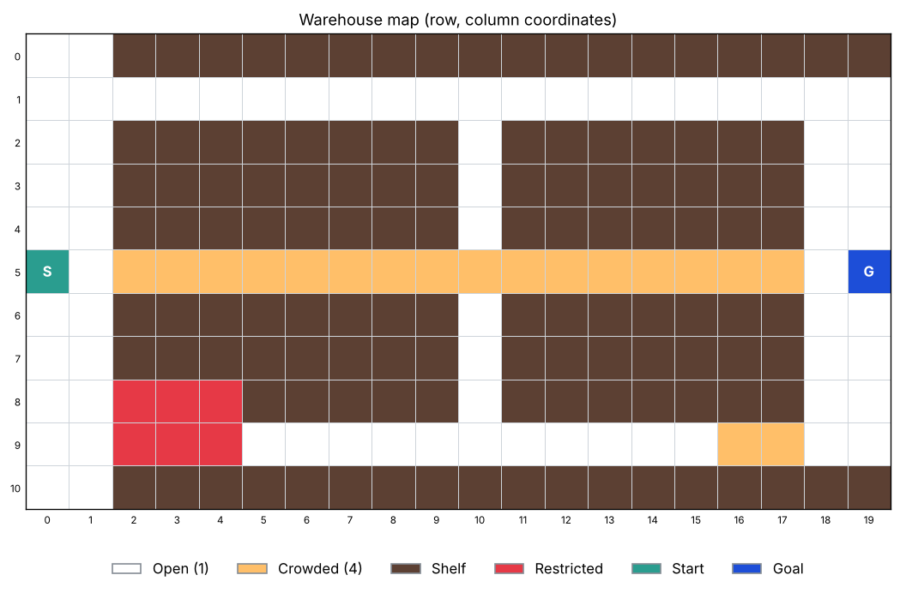
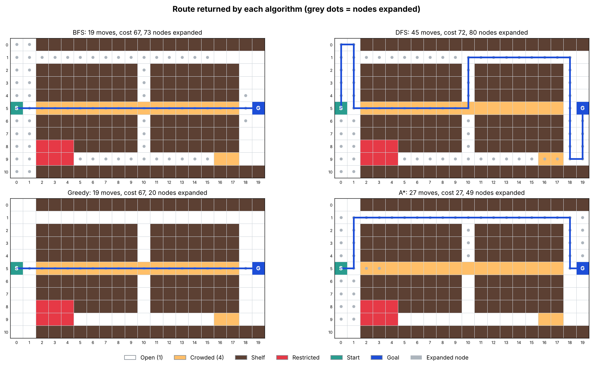
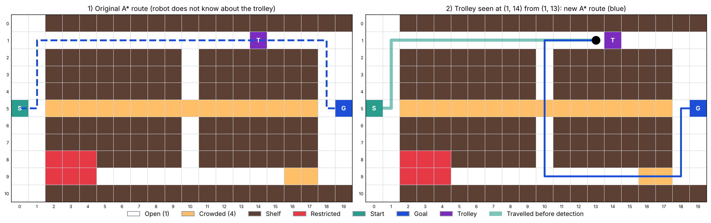
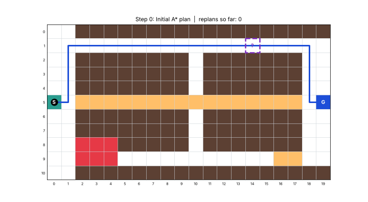
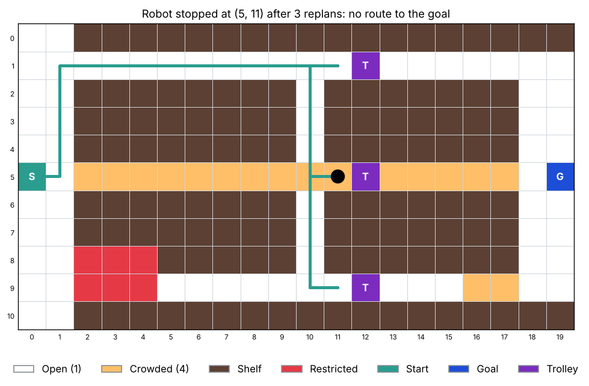
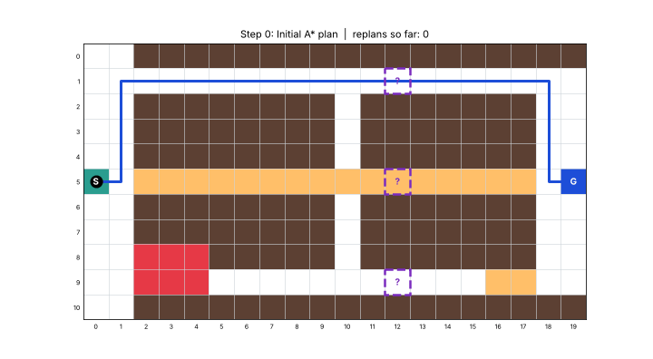
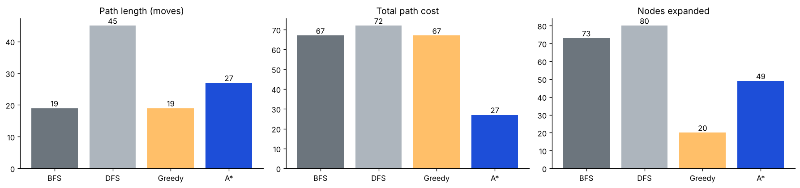

# AI-Based Route Planning for a Warehouse Delivery Robot

**Artificial Intelligence – Coding Assignment, IIIT Nagpur**

| Name | Roll No. | Contribution |
|---|---|---|
| Akshat Jain | BT23CSD020 | Complete work (individual submission): grid and problem formulation, BFS, DFS, Greedy Best-First Search, A\*, trolley detection and replanning, visualisation, performance comparison and documentation |

---

## 1. Problem statement

A warehouse robot carries packages from a packing station to a dispatch area. Shelves and restricted zones block some routes, and crowded aisles take longer to cross. A trolley may also block a route that the robot initially believes is clear.

This project simulates the robot on a 2D grid, compares **BFS, DFS, Greedy Best-First Search and A\***, and shows how the robot detects a trolley that is not on its map and **replans with A\***.

## 2. Repository contents

| File | Description |
|---|---|
| `warehouse_robot.py` | Complete source code. Running it prints all results and saves every figure and animation in `outputs/`. |
| `Warehouse_Robot.ipynb` | Same code split into explained cells, with all outputs (open it on GitHub or in Google Colab). |
| `outputs/` | Screenshots (`.png`), animations (`.gif`) and the full console output (`console_output.txt`). |
| `requirements.txt` | Python dependencies. |

## 3. How to run

**Option 1 – Google Colab:** upload `Warehouse_Robot.ipynb` to [Google Colab](https://colab.research.google.com) and choose **Runtime → Run all**. No installation is needed.

**Option 2 – Local machine (Python 3.8+):**

```bash
pip install -r requirements.txt
python warehouse_robot.py
```

The program prints the routes, the trolley experiments and the comparison tables, and writes all images to `outputs/`.

## 4. Task 1 – Warehouse environment

| Symbol | Cell | Cost to enter |
|---|---|---|
| `.` | Open aisle | 1 |
| `C` | Crowded aisle | 4 |
| `#` | Shelf | Impassable |
| `X` | Restricted zone | Impassable |
| `S` | Packing station (start) | 1 |
| `G` | Dispatch area (goal) | 1 |
| `T` | Trolley (only in the trolley experiments) | Impassable |

The 11 × 20 grid has three horizontal aisles (top, middle, bottom) joined by cross-aisles at the left, centre and right. The middle aisle is crowded: it is the shortest way to the goal but expensive. The top aisle is longer, but every cell costs 1. Part of the bottom aisle is a restricted zone. The robot moves up, down, left or right.



## 5. Task 2 – Problem formulation

| Component | Definition |
|---|---|
| State | Robot position `(row, col)` |
| Initial state | Packing station `S` = (5, 0) |
| Actions | Up, Down, Left, Right, only into cells inside the grid that are not a shelf, restricted zone or known trolley |
| Transition model | Up → `(r-1, c)`, Down → `(r+1, c)`, Left → `(r, c-1)`, Right → `(r, c+1)` |
| Goal test | State equals the dispatch area `G` = (5, 19) |
| Path cost | Sum of the cost of every cell entered: 1 for an open cell, 4 for a crowded cell |

## 6. Task 3 – Search algorithms

All four algorithms are implemented in one `search()` function; only the frontier changes. Each one is a graph search (a cell is expanded at most once), and the goal test is done when a node is expanded, so nodes expanded are counted the same way for all four.

| Algorithm | Frontier | Expands next | Guarantee |
|---|---|---|---|
| BFS | FIFO queue | Oldest node | Fewest moves (not lowest cost) |
| DFS | LIFO stack | Newest node (actions tried in the order Up, Down, Left, Right) | None |
| Greedy Best-First | Priority queue on `h(n)` | Node that looks closest to the goal | None |
| A\* | Priority queue on `f(n) = g(n) + h(n)` | Lowest cost so far + estimate | Lowest-cost route |

**Heuristic – Manhattan distance:** `h(n) = |row(n) − row(G)| + |col(n) − col(G)|`.

**Why it is a lower bound on the remaining travel cost:** the robot moves one cell at a time and only up, down, left or right, so it needs at least |Δrow| + |Δcol| moves to reach the goal. Every move costs at least 1, so the remaining cost is at least the Manhattan distance. Shelves, restricted zones, trolleys and crowded cells can only make the real cost higher, never lower. The heuristic therefore never overestimates (it is admissible), and A\* returns the lowest-cost route.



**Short crowded route vs longer cheaper route:**

| Route | Moves | Cost |
|---|---|---|
| Middle aisle (short, crowded) | 19 | 67 |
| Top aisle (longer, open) | 27 | 27 |

BFS, which minimises moves, took the middle aisle. A\*, which minimises cost, took the top aisle.

When every aisle is blocked (trolleys at column 12 in all three aisles), all four algorithms print `NO ROUTE FOUND`.

## 7. Task 4 – Trolley detection and replanning

- The robot plans with A\* on its **known map**, which does not contain the trolley.
- Before entering the next cell of its route, its sensor checks that cell in the **real warehouse**.
- If a trolley is there, the robot adds it to its known map and **replans with A\* from its current position**.
- If A\* finds no route on the updated map, the robot stops and reports that no alternative route exists.

**Scenario A – one trolley on the initial A\* route.** The trolley is placed automatically on the initial A\* route at (1, 14). The robot detects it from (1, 13), replans once, and reaches the goal through the centre cross-aisle and the bottom aisle.





**Scenario B – no alternative route.** Hidden trolleys block the top, middle and bottom aisles at column 12. The robot discovers them one at a time, replans after each, and reports that no route exists after the third detection.





## 8. Task 5 – Performance evaluation

**Search algorithms on the warehouse grid**

| Algorithm | Goal reached | Path length (moves) | Total path cost | Nodes expanded | Time (ms) |
|---|---|---|---|---|---|
| BFS | Yes | 19 | 67 | 73 | 0.199 |
| DFS | Yes | 45 | 72 | 80 | 0.183 |
| Greedy Best-First | Yes | 19 | 67 | 20 | 0.063 |
| A\* | Yes | **27** | **27** | 49 | 0.125 |

**Trolley experiments (A\* with replanning)**

| Scenario | Goal reached | Moves travelled | Cost travelled | Nodes expanded (all A\* searches) | Replans | Time (ms) |
|---|---|---|---|---|---|---|
| A: one trolley | Yes | 41 | 50 | 95 | 1 | 3.941 |
| B: every aisle blocked | No (no alternative route) | 31 | 40 | 183 | 3 | 0.704 |

Times are from one run and vary slightly between runs; all other values are fixed.



## 9. Findings

- **The shortest route did not have the lowest cost.** BFS returned the shortest route (19 moves) through the crowded middle aisle, with cost 67. A\* returned a longer route (27 moves) through the open top aisle with cost 27, the lowest possible.
- **Greedy Best-First** expanded the fewest nodes (20) but followed the Manhattan distance straight into the crowded aisle, because it ignores the cost already paid. Its route cost 67.
- **DFS** went deep in the first direction it tried and wandered around the warehouse: 45 moves and cost 72, neither shortest nor cheapest.
- **A\*** expanded more nodes than Greedy but is the only algorithm that guarantees the lowest-cost route, because Manhattan distance never overestimates the remaining cost.
- **Replanning:** with one hidden trolley the robot stopped in front of it, updated its map and reached the goal after one replan. Because the robot only learns about the trolley when it is next to it, it had to walk back to the centre cross-aisle, so the travelled cost (50) is higher than the original plan (27). When every aisle was blocked, the robot replanned three times and correctly reported that no alternative route exists.

## 10. Dependencies

- Python 3.8 or newer
- `matplotlib` (grid figures and animations)
- `pillow` (saving the GIF animations)

The search algorithms use only the Python standard library (`heapq`, `collections.deque`).

## 11. References

- S. Russell and P. Norvig, *Artificial Intelligence: A Modern Approach*, 3rd ed., Pearson – Chapter 3 (problem formulation, uninformed search, Greedy Best-First Search, A\*, admissible heuristics).
- CSL 421 Artificial Intelligence lecture notes, IIIT Nagpur.
- Python documentation for `heapq` and `collections.deque`; Matplotlib documentation for `imshow` and `FuncAnimation`.
